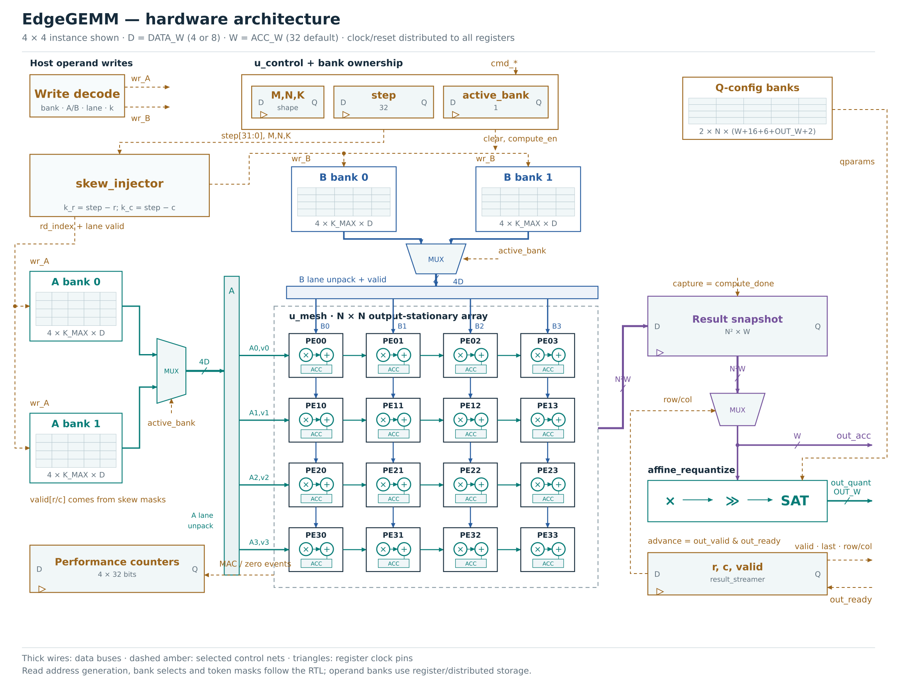
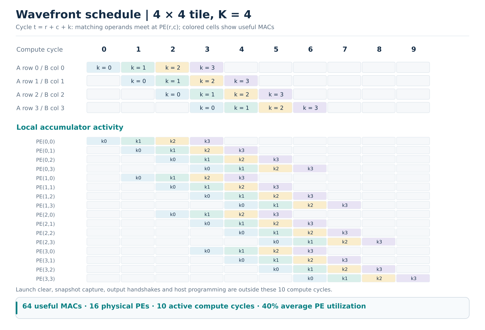
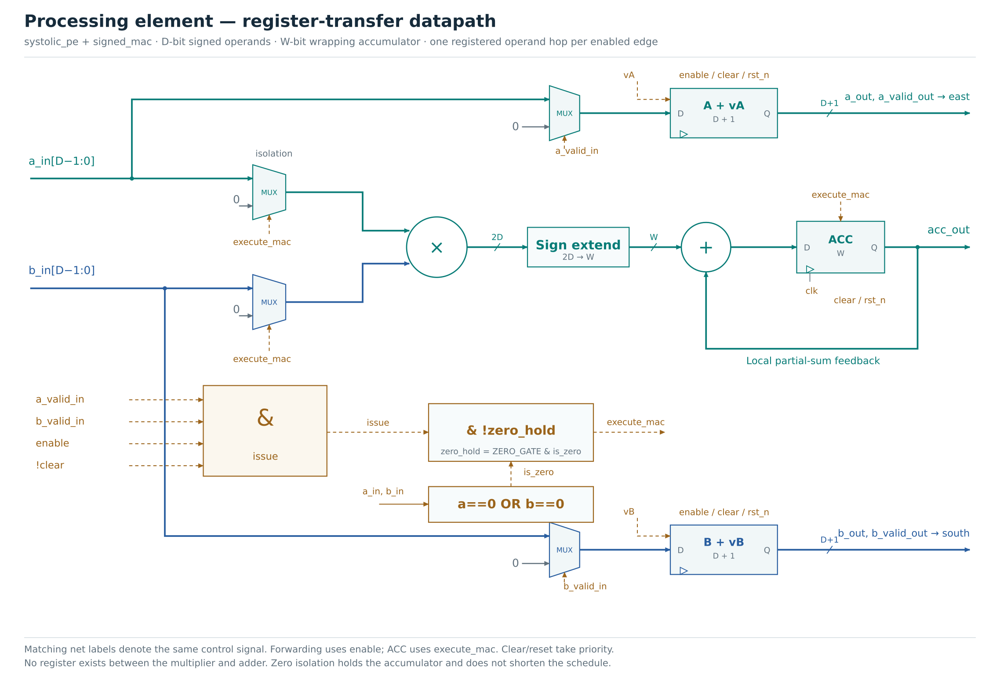
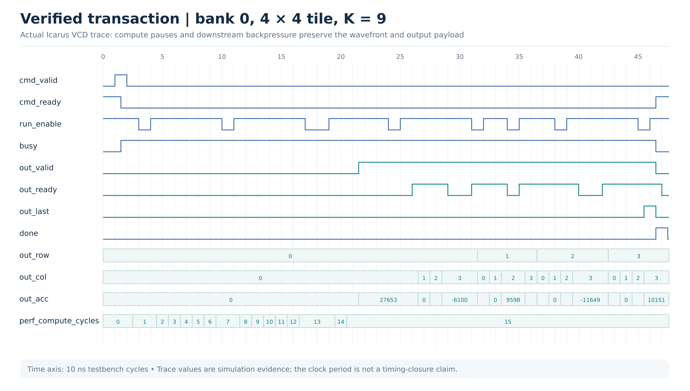

# EdgeGEMM

**A modular, exact integer systolic matrix engine in SystemVerilog, with INT4/INT8 configurations, double-buffered operands, and verified streaming output.**

Maintainer: **Matin Firoozbakht** · [@matinfirooz](https://github.com/matinfirooz)

EdgeGEMM maps one rectangular `M × K` by `K × N` tile onto an output-stationary PE mesh. Operands move through registered neighbor links; each PE owns one accumulator. The enhanced core supports overlapping writes to the inactive operand bank, partial tiles, compute pauses, and a result stream that remains stable under backpressure.

The original `edgegemm_top` interface is also included. Start with that wrapper for the original 4×4 example, or use `edgegemm_core` for the extended features.



## What is implemented

| Capability | Implementation |
|---|---|
| Modular RTL | 16 synthesizable modules; a dedicated self-checking bench for each |
| Arithmetic | Exact signed multiply; configurable signed accumulator, default INT32 |
| Input precision | `DATA_W=4` or `8`, selected at elaboration; not runtime precision switching |
| Tile shape | Runtime `1 ≤ M,N ≤ physical N`, `1 ≤ K ≤ K_MAX` |
| Operand storage | Two banks each for A and B; one parallel read per physical lane |
| Bank ownership | Current bank protected through the final result handshake |
| Host overlap | Inactive-bank operand/config writes may overlap compute and result drain |
| Valid tokens | Bubbles and unused rows/columns never update accumulators |
| Global compute pause | Controller step, operand hops, valid bits and accumulators hold together |
| Optional zero hold | Isolate zero products and hold the accumulator; exact results, unchanged schedule |
| Quantization | Per-column bias, unsigned 16-bit multiplier, shift, rounding, output zero point, ReLU and saturation |
| Result transport | Row-major `valid/ready`, raw accumulator and quantized result together, `last` flag |
| Observability | Compute cycles, compute pause cycles, valid MACs and gated zero MACs |
| Software | Original C model plus dependency-free Python GEMM, wavefront and host tiling models |
| Verification | 53 RTL runs across parameter settings; Python/C checks; strict Verilator lint |
| Build flow | Make targets, checked-in vectors, CI, optional generic Yosys synthesis |
| Visuals | Hardware schematics for the core, PE, banking and quantizer; schedule and actual waveform; SVG/PNG/vector PDF |

## Quick start

Use Linux, macOS with the tools installed, or Ubuntu under WSL2 on Windows. From the extracted repository root:

```bash
# Ubuntu / Debian / Ubuntu on WSL
sudo apt-get update
sudo apt-get install -y build-essential python3 iverilog verilator yosys

# Complete C, Python and RTL verification
make test

# Strict lint of both top-level interfaces
make lint

# Larger matrix mapped into multiple hardware-sized commands
make demo
```

The core/reference flow has **no pip dependencies**. PNG/PDF figure regeneration additionally uses Inkscape or the optional `cairosvg` package; the supplied SVG/PNG/PDF figures are ready to use.

Useful targets:

| Command | Result |
|---|---|
| `make test` | C test, 9 Python test methods, complete 53-run RTL regression |
| `make test-unit` | One simulation for each of the 16 RTL modules |
| `make test-rtl` | Unit benches plus array/precision/gating parameter sweep |
| `make sim` | Alias for the complete RTL regression |
| `make test-python` | Integer arithmetic, wavefront and host tiling checks |
| `make test-c` | Original signed 4×4 C golden model |
| `make vectors` | Regenerate C legacy vectors and Python rectangular integration vectors |
| `make wave` | Enhanced-core simulation with `build/core.vcd` |
| `make synth` | Generic synthesis for a 4×4, `K_MAX=8`, INT8 core |
| `make figures` | Regenerate the four hardware SVG schematics and the schedule diagram |
| `make clean` | Remove generated `build/` files |

`IVERILOG`, `VVP`, `VERILATOR`, `YOSYS`, `CC` and `PYTHON` can be overridden. Missing required tools fail the command; checks are not silently skipped.

## Choose an interface

| Top module | Intended use | Completion and readout |
|---|---|---|
| `edgegemm_top` | Original square-tile host interface | Pulse `start`; wait for `done`; select `result_row/col` |
| `edgegemm_core` | Banked rectangular tiles and streaming integration | Command handshake; consume exactly `M*N` output handshakes; `done` follows the last |

The legacy port names and final compute latency remain compatible. Legacy `perf_cycles` now updates during compute. The enhanced core has an additional capture edge and a result-drain phase; its `done` therefore has a different meaning from the legacy wrapper.

See [the complete port/protocol reference](docs/interface.md) and [migration notes](docs/migration.md).

## RTL hierarchy and unit benches

| Module | Responsibility | Dedicated testbench |
|---|---|---|
| [`signed_mac`](rtl/signed_mac.sv) | Signed multiply, accumulation, operand isolation and event flags | [`tb_signed_mac`](tb/tb_signed_mac.sv) |
| [`pe`](rtl/pe.sv) | Original PE interface and operand forwarding | [`tb_pe`](tb/tb_pe.sv) |
| [`systolic_pe`](rtl/systolic_pe.sv) | Independent A/B valid forwarding and qualified MAC | [`tb_systolic_pe`](tb/tb_systolic_pe.sv) |
| [`systolic_mesh`](rtl/systolic_mesh.sv) | Parameterized neighbor-connected PE grid | [`tb_systolic_mesh`](tb/tb_systolic_mesh.sv) |
| [`operand_buffer`](rtl/operand_buffer.sv) | Two-bank, multi-lane operand storage with guarded addressing | [`tb_operand_buffer`](tb/tb_operand_buffer.sv) |
| [`skew_injector`](rtl/skew_injector.sv) | Lane-specific k addresses and partial-tile valid masks | [`tb_skew_injector`](tb/tb_skew_injector.sv) |
| [`tile_controller`](rtl/tile_controller.sv) | Shape validation, launch/clear, pause and wavefront completion | [`tb_tile_controller`](tb/tb_tile_controller.sv) |
| [`perf_counters`](rtl/perf_counters.sv) | Qualified cycle and MAC event counting | [`tb_perf_counters`](tb/tb_perf_counters.sv) |
| [`result_buffer`](rtl/result_buffer.sv) | Snapshot and guarded accumulator readback | [`tb_result_buffer`](tb/tb_result_buffer.sv) |
| [`result_streamer`](rtl/result_streamer.sv) | Backpressure-safe row/column/last sequencing | [`tb_result_streamer`](tb/tb_result_streamer.sv) |
| [`channel_config`](rtl/channel_config.sv) | Two banks of per-column affine parameters | [`tb_channel_config`](tb/tb_channel_config.sv) |
| [`requantize`](rtl/requantize.sv) | Legacy arithmetic shift, ReLU and saturation | [`tb_requantize`](tb/tb_requantize.sv) |
| [`affine_requantize`](rtl/affine_requantize.sv) | Widened integer affine output conversion | [`tb_affine_requantize`](tb/tb_affine_requantize.sv) |
| [`systolic_array`](rtl/systolic_array.sv) | Original square-array interface using the new components | [`tb_systolic_array`](tb/tb_systolic_array.sv) |
| [`edgegemm_top`](rtl/edgegemm_top.sv) | Original accelerator plus legacy quantizer | [`tb_edgegemm_top`](tb/tb_edgegemm_top.sv) |
| [`edgegemm_core`](rtl/edgegemm_core.sv) | Enhanced command, bank, compute and stream integration | [`tb_edgegemm_core`](tb/tb_edgegemm_core.sv) |

Compile from the repository root with `-f rtl/files.f`. Lane zero and PE `(0,0)` occupy the least significant packed slice. The two public tops share the arithmetic/scheduling components; `pe` is a compatibility leaf, while the enhanced mesh uses `systolic_pe`.

## Dataflow and timing

For PE `(r,c)`, inject `A[r,k]` at active step `r+k` and `B[k,c]` at active step `c+k`. Registered forwarding makes both operands arrive at `r+c+k`. Valid bits travel with each operand and freeze during compute pauses.



For a runtime tile `m × k` by `k × n`:

```text
Useful MACs             m * n * k
Physical PEs            N * N
Active compute cycles   k + m + n - 2
Average PE utilization  (m*n*k) / (N*N*(k+m+n-2))
```

Example wavefront counts, excluding load, launch, capture, output drain and stalls:

| Physical array | Tile M×K×N | Useful MACs | Active compute cycles |
|---|---|---:|---:|
| 1×1 | 1×1×1 | 1 | 1 |
| 4×4 | 4×4×4 | 64 | 10 |
| 4×4 | 3×7×4 | 84 | 12 |
| 4×4 | 4×16×4 | 256 | 22 |
| 8×8 | 8×11×8 | 704 | 25 |

For the enhanced core with continuous compute and `out_ready=1`, the last output is accepted **`L + 1 + m*n` rising edges after command acceptance**, where `L=k+m+n-2`. The extra edge snapshots the completed mesh and starts streaming. Input/config programming occurs separately. Compute pauses add to L; result backpressure adds to drain time.

`ZERO_GATE` does not reduce the cycle count or compress sparse data. It changes operand isolation/accumulator enables. The counters measure the opportunity; physical power savings require activity-based implementation results.

## Processing element and arithmetic



These are hardware schematics with clocked registers, mux symbols, multipliers, adders, buses and control nets. Additional views expand the operand-bank read path and the affine integer quantizer. Download editable SVGs, PNG previews or vector PDFs from the [complete figure gallery](docs/figures/README.md).

| Hardware detail | Preview | Vector figure |
|---|---|---|
| Operand banking and read mux | [PNG](docs/figures/banking.png) | [PDF](docs/figures/banking.pdf) |
| Affine integer requantizer | [PNG](docs/figures/requantization.png) | [PDF](docs/figures/requantization.pdf) |

All operands are signed two's-complement integers. An active valid pair produces a `2*DATA_W`-bit product, sign-extended to `ACC_W`. Accumulation wraps modulo `2**ACC_W`; it does not saturate. The test suite includes INT4 extrema and an 8-bit accumulator overflow configuration.

A conservative no-overflow choice for a K-length dot product is `ACC_W >= 2*DATA_W + ceil(log2(K))`. The default accumulator is 32 bits. The RTL requires `ACC_W >= 2*DATA_W` and assumes the caller chooses a width suitable for its workload.

The enhanced quantizer computes:

```text
p = (acc + bias[column]) * unsigned_multiplier[column]
s = floor(p / 2**shift)                 # rounding disabled
s = nearest(p / 2**shift), ties away    # rounding enabled
q = s + output_zero_point[column]
q = max(q, output_zero_point[column])  # optional ReLU
q = clamp(q, signed OUT_W range)
```

Bias addition and multiplication are widened before shifting, so two INT32 operands can be added without an unintended INT32 wrap. Multiplier range is `0..65535`, shift range `0..63`. ReLU clamps at the quantized representation of real zero. Input tensors use signed symmetric integers: input zero points are not subtracted by the GEMM datapath.

## Host programming sequence

1. Reset. Drive host valid signals low during reset.
2. Program every needed `A[row,k]` and `B[k,col]` into a chosen bank. A writes use `load_lane=row`; B writes use `load_lane=col`; both use `load_index=k`.
3. Optionally write that bank's per-column output parameters. Reset defaults are bias 0, multiplier 1, shift 0, zero point 0, no ReLU, no rounding.
4. Present `cmd_bank`, `cmd_rows`, `cmd_cols`, `cmd_depth` and `cmd_valid`. Hold them until `cmd_ready` is high on a rising edge.
5. Consume the output stream with `out_ready`. Every field remains stable while `out_valid && !out_ready`. The final accepted beat carries `out_last=1`.
6. While the job is active, program the other bank for a later command. Launch that command after the previous result stream completes.

An unprogrammed cell reads zero **after reset**. Previously written cells persist between commands; rewrite all needed operands or deliberately reuse them. Read/write addresses are bounds checked. Invalid accepted writes are ignored and pulse the corresponding error flag. An invalid accepted command pulses `cmd_error` without launching a job.

This engine has one compute/result tile in flight. Double buffering overlaps host preparation with that tile; it does not overlap two mesh computations or queue commands.

## Larger matrices and K splitting

The Python model demonstrates tail tiles and arbitrary host matrix dimensions:

```bash
python3 sw/model.py --m 13 --k 37 --n 11 --array 4 --k-max 16 --bits 4
```

Expected:

```text
PASS 13x37 @ 37x11; INT4; 36 tile commands
Active wavefront cycles (sum): 621
K chunks are combined by the host before final requantization.
```

Each hardware command clears its accumulators. For K larger than `K_MAX`, the host combines `out_acc` values across K chunks and requantizes after the final sum. Summing already-quantized chunk results is generally incorrect. `sw/model.py` models this host work; it is not a DMA driver or an autonomous RTL tiler.

## Verification and waveform evidence

The release includes all 16 module benches and 53 passing RTL runs spanning physical sizes 1, 2, 3, 4 and 8, INT4/INT8, zero hold enabled/disabled, and narrow-accumulator overflow. Integration checks cover signed extrema, partial tiles, bank overlap/protection, invalid commands/addresses, repeat launches, compute pauses, stalled output payloads, MAC counters and reset during compute/drain.

An independent Python fixture exercises a `3×7 @ 7×4` INT8 tile through the real host ports and compares both raw and quantized outputs. See [`vectors/core_fixture.json`](vectors/core_fixture.json). The C model preserves the original known-answer test.



Generate a fresh VCD with `make wave`. A compressed representative trace is included at [`docs/waveforms/core.vcd.gz`](docs/waveforms/core.vcd.gz); decompress it before opening in GTKWave. The 10 ns simulation clock is a testbench setting, not a measured maximum clock frequency.

Read [the verification plan](docs/verification.md), [module bench notes](tb/README.md) and [captured release results](reports/verification.md). Results are reproducible checks, not a formal proof or a functional coverage percentage.

## Generic synthesis

```bash
make synth
python3 tools/synthesize.py --n 4 --k-max 8 --bits 4 --zero-gate 0
```

The script uses Yosys `synth -noabc` and `check -assert`, and writes generic cell statistics and a netlist into `build/`. The release includes four matched structural runs varying INT4/INT8 and zero hold. See [synthesis results and limits](reports/synthesis.md).

Operand buffers are an asynchronous-read register/distributed-storage reference. They do not claim block-SRAM inference. A synchronous SRAM/BRAM implementation needs a read-latency-aware injector/controller. No process technology, physical area, maximum frequency, routed timing or energy figure is claimed by these generic counts.

## Repository map

| Directory | Contents |
|---|---|
| `rtl/` | All modules and ordered source list |
| `tb/` | Dedicated unit and integration benches, shared assertion macro |
| `sw/` | C golden/vector generator; Python arithmetic, wavefront and host tiling models |
| `tests/` | Standard-library Python unit tests |
| `vectors/` | Legacy and independent rectangular integration fixtures |
| `tools/` | Regression, synthesis, figure and release scripts |
| `docs/` | Architecture, full interface, migration, verification, figures and waveform |
| `reports/` | Captured verification and generic synthesis evidence |
| `.github/workflows/` | CI for tests, strict lint and synthesis |

## Scope and next experiments

The host interface is native valid/ready, not AXI. The project does not include external memory, DMA, CDC, a physical clock-gating cell, runtime precision switching or a gate-level equivalence proof. Useful next experiments are synchronous SRAM banking, overlapping compute with result capture in a second result bank, an AXI adapter, and matched activity-based power comparison of the zero-hold option.

The CI workflow runs verification, strict lint and structural synthesis on push/pull request; it was added to this package and must run in your GitHub repository after upload. Unzip and upload the **contents of `EdgeGEMM/`** so that `README.md`, `Makefile` and `.github/` sit at the repository root.

## License

MIT. The original license notice is retained in [`LICENSE`](LICENSE).
