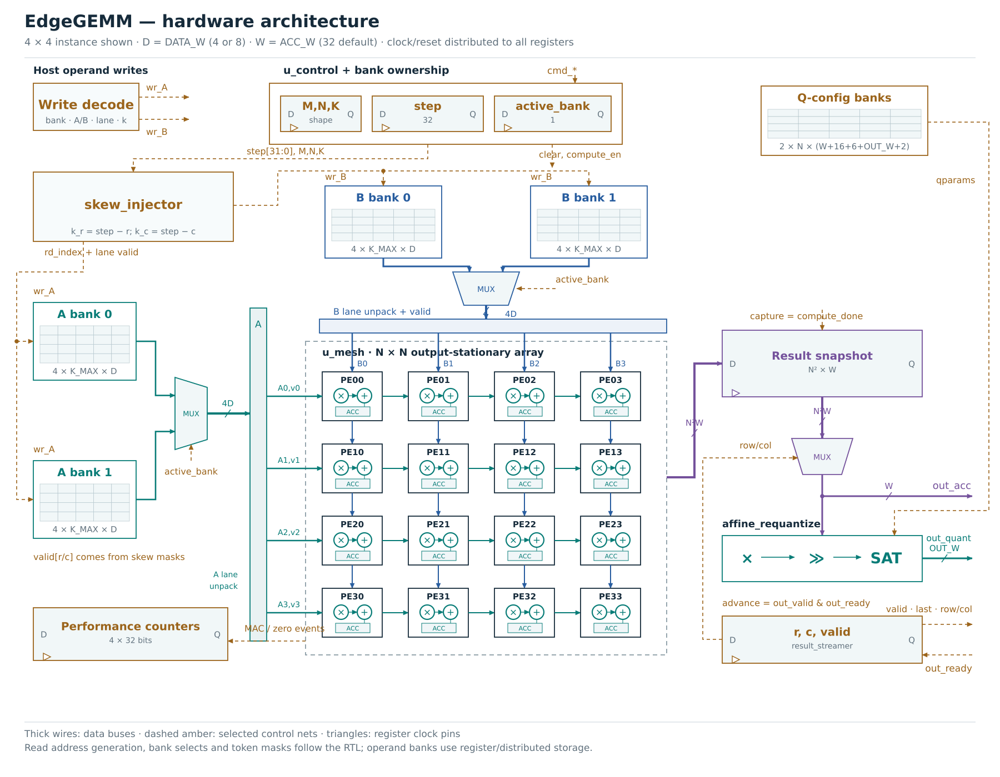
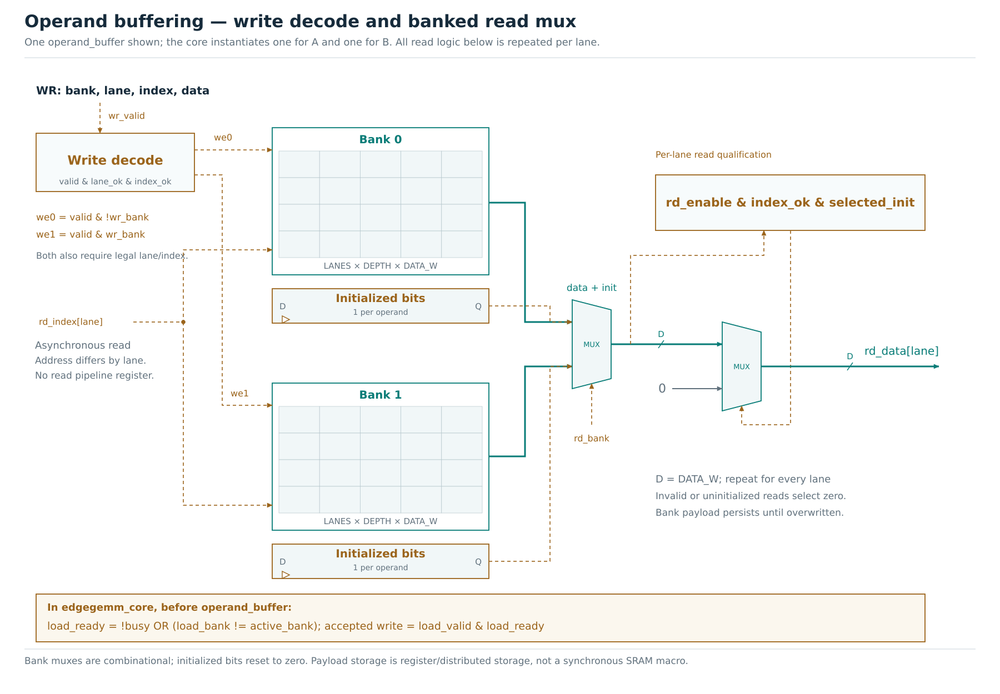
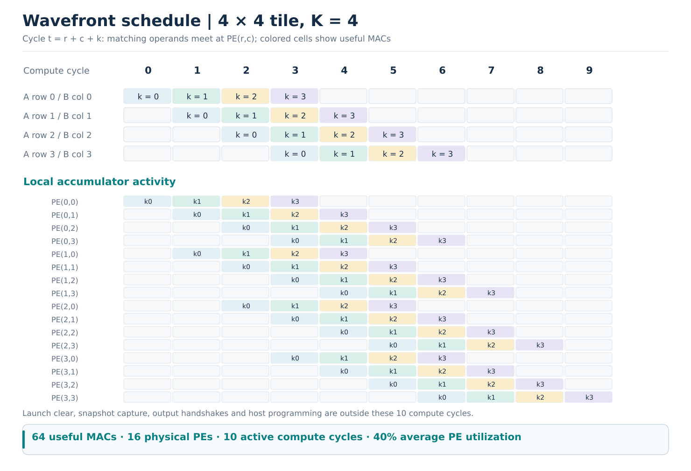
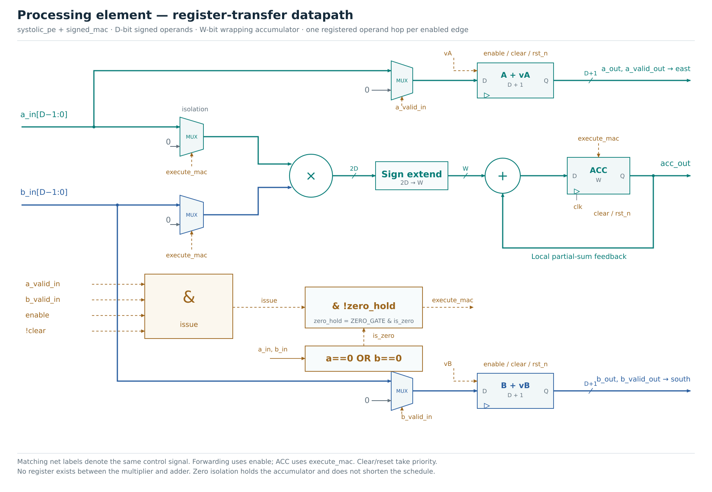
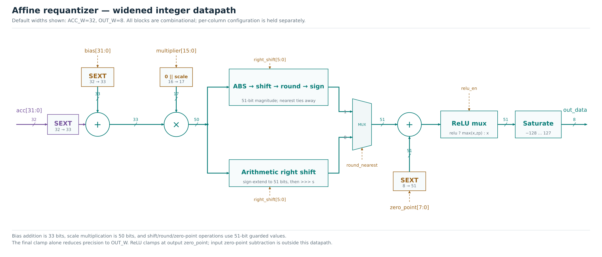

# Architecture and scheduling

## Storage and ownership

`edgegemm_core` instantiates two `operand_buffer` modules. Each contains two banks with N independently addressed lanes of K_MAX operands. A lanes are rows; B lanes are columns. A shared scalar host port writes either module, and all lanes read their own k coordinate in parallel.

The command bank is latched on a valid accepted command. That bank owns A, B and the matching `channel_config` parameters through compute, capture and output drain. A load/config request to the owned bank has ready low. Other-bank writes can proceed. Ownership ends after the last output handshake; the next command can be accepted on the following rising edge.

Payload storage is a reference implementation using asynchronous reads and register arrays. Initialized bits make missing reads return zero after reset without resetting every payload register. No SRAM macro, BRAM read latency or DMA is hidden behind the interface.

## Wavefront proof

At active step t, A lane r requests k=t-r; B lane c requests k=t-c. A travels c registered horizontal links to PE(r,c); B travels r vertical links. Both therefore arrive when t=r+c+k. Induction on the link count gives equality of the two k values at each useful PE event. Their valid bits remove bubbles and mask unused physical rows/columns.

For runtime row count m, column count n and depth k, the last useful event is `(m-1)+(n-1)+(k-1)`. Counting steps from zero gives `L=k+m+n-2` active compute edges. A global pause holds both the step and every operand/valid register, preserving alignment without per-token k tags.

## Processing element

`systolic_pe` forwards each operand and its validity independently. Only a simultaneous valid A/B pair updates `signed_mac`. Invalid forwarding data is driven to zero. Clear has priority over enable, and asynchronous reset clears state.

With ZERO_GATE enabled, a zero operand pair produces a valid MAC event and a zero-hold event, while multiplier inputs are isolated and the accumulator holds. With ZERO_GATE disabled, a valid zero pair executes normally. Both produce identical integer results. This option provides a controlled ablation, not a sparse scheduling engine.

## Capture and drain

On the final active compute edge the mesh performs its last MAC and the controller raises `compute_done`. On the next edge, `result_buffer` captures the now-settled accumulators and `result_streamer` begins at row 0, column 0. This separate edge avoids capturing the previous nonblocking-assignment values.

The streamer advances only on `out_valid && out_ready`. The snapshot and owned quantization bank remain unchanged, so coordinates, raw/quantized data and last all hold through any downstream stall. Only one tile's result snapshot exists. The engine waits for drain before accepting another tile command.

Without pauses/backpressure, a command at edge E computes on E+1..E+L, captures on E+L+1, and transfers its first beat on E+L+2. Its last of m*n beats transfers at E+L+1+m*n. The enhanced done pulse follows that final edge. The legacy wrapper has no capture/drain phase and raises done on its last MAC.

## Arithmetic widths

Products are signed 2*DATA_W bits. Accumulation is signed ACC_W with modular wrap. This is exact integer arithmetic under that specified width, not unbounded integer arithmetic. Bias addition in the enhanced quantizer is ACC_W+1 bits; multiplication by a positive 17-bit representation of the uint16 scale is ACC_W+18 bits. A further guard bit supports magnitude rounding and output zero-point addition before saturation.

Rounding nearest uses the product magnitude, adds half of the scale denominator, shifts, and restores the sign. The implementation avoids taking a minimum signed value's absolute value at the same width. Arithmetic floor uses a signed right shift, including shifts above the product width.

## Storage accounting

Ignoring control/register overhead, the enhanced core holds:

| State | Bits |
|---|---:|
| Two banks each of A and B | `4*N*K_MAX*DATA_W` |
| Operand initialized flags | `4*N*K_MAX` |
| PE accumulators | `N*N*ACC_W` |
| Result snapshot | `N*N*ACC_W` |
| Two banks of channel tuples | `2*N*(ACC_W+16+6+OUT_W+2)` |
| PE operand hop registers | `2*N*N*DATA_W` |
| PE valid hop registers | `2*N*N` |

There is one selected result readout/quantization path, delivering at most one output per cycle. It does not expose N*N simultaneously quantized outputs. A production synchronous memory design must account for read latency and local address generation.

## Host tiling boundary

Hardware handles one tile bounded by N and K_MAX. `sw/model.py` decomposes larger matrices and combines raw partial sums across K chunks in software. Output quantization occurs after host K accumulation. An autonomous scheduler, DMA and inter-command on-chip partial-sum accumulation are outside this implementation.
